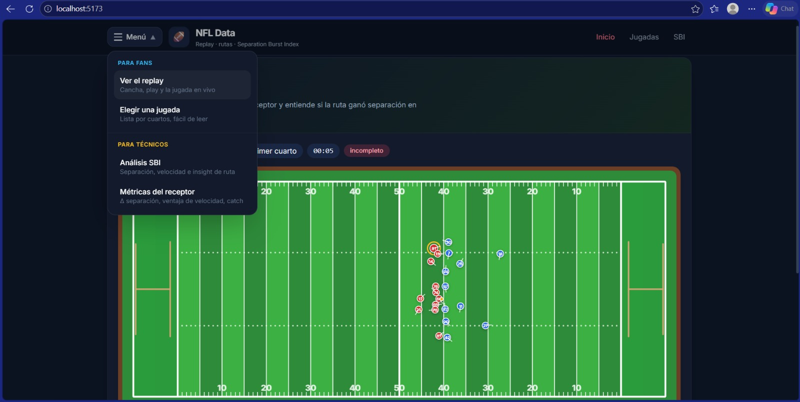

#  NFL Big Data Bowl UNAM

NFL Data mide cuánta separación gana un receptor frente a su defensor más cercano en los primeros 1.5 segundos después del snap, usando datos de tracking reales de la NFL. Esa medida se resume en el Separation Burst Index (SBI), que combina el cambio de separación, la ventaja de velocidad y la separación al momento de la recepción. Un SBI menor a 0 indica una ruta cubierta, entre 2 y 5 una separación útil, y mayor a 5 un dominio claro de la ruta. Está pensado para coaches, scouts y comentaristas que quieren evaluar rutas jugada por jugada. Para verlo, elige una jugada y un receptor en el dashboard: verás el campo animado, la curva de separación y el SBI con una lectura breve.
